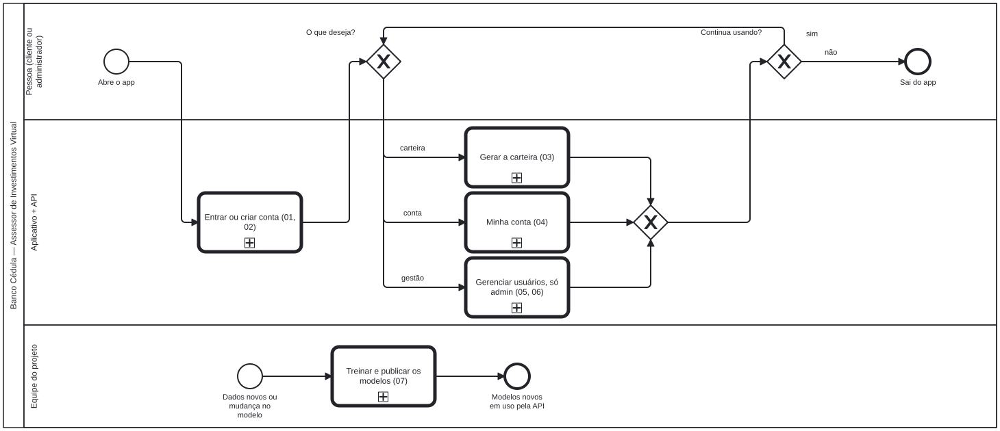
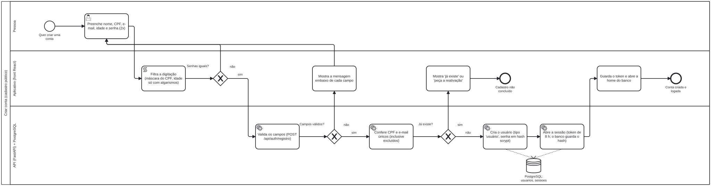
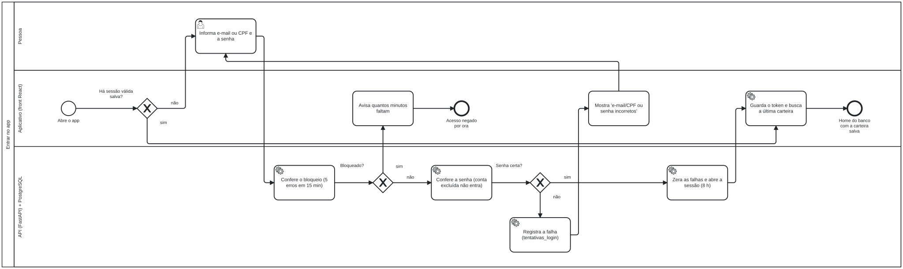
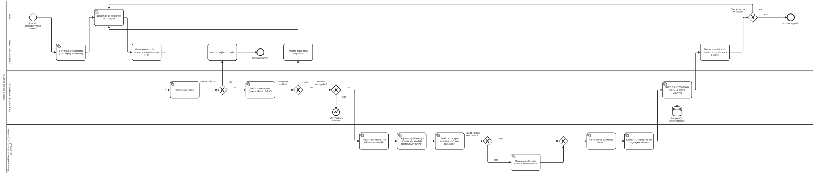
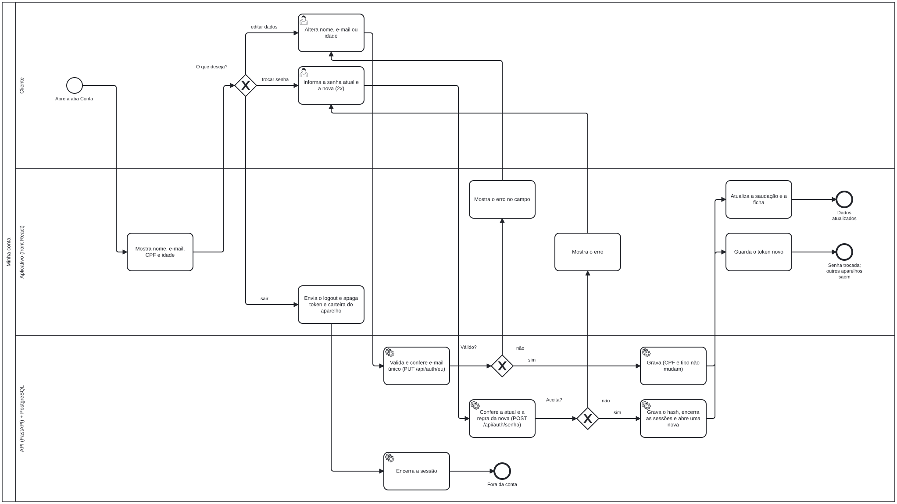
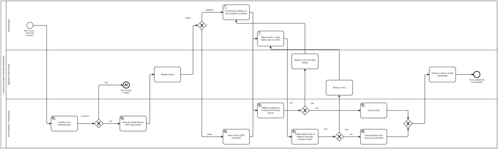
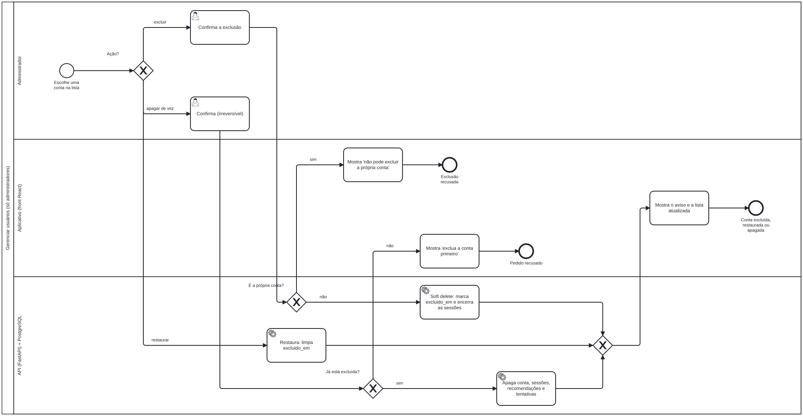
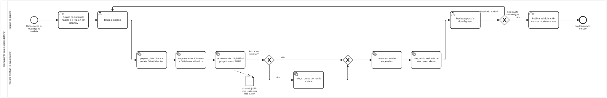

# Fluxos to-be (BPMN 2.0)

Processos do **Assessor de Investimentos Virtual** dentro do app do Banco Cédula, no estado alvo:
login obrigatório, usuários num PostgreSQL (D40, D41) e recomendação ligada à conta.

Cada fluxo tem dois arquivos:

- **`.bpmn`**: o diagrama editável (BPMN 2.0 com o desenho). Abra em <https://demo.bpmn.io> (arraste o
  arquivo para a página) ou no [Camunda Modeler](https://camunda.com/download/modeler/).
- **`.svg`**: a imagem exportada do `.bpmn`, que aparece abaixo e no GitHub.

Ao editar um `.bpmn`, exporte o SVG de novo pelo próprio editor ("Export as SVG"), para a imagem não
ficar desatualizada.

## Convenções

| Raia | Quem |
|---|---|
| Pessoa / Cliente / Administrador | quem usa o app |
| Aplicativo (front React) | `frontend/src`: só filtra a digitação e mostra o que a API devolve |
| API (FastAPI) + PostgreSQL | `api/`: valida, decide e grava |
| Motor: modelos de IA + regras | `src/advisor.py` (modelos) e `src/portfolio.py` (regras, sem ML) |
| Equipe do projeto / Pipeline | treinamento offline (`python -m src.pipeline`) |

- Tarefa com **boneco** = feita pela pessoa; com **engrenagem** = automática (serviço); com **mão** = manual.
- **Losango com X** = decisão (só um caminho segue); losango sem nome junta caminhos.
- **Círculo grosso** = fim; com **raio** = fim com erro (ex.: 403, 503).
- **Caixa com +** (na visão geral) = subprocesso detalhado em outro arquivo.
- Muitas tarefas têm uma descrição a mais (campo *Documentation*), visível no editor.

## 00 — Visão geral

Mapa dos processos: entrar, escolher o que fazer e voltar ao início; o treinamento dos modelos corre à parte.

## 01 — Criar conta

O front filtra a digitação; o servidor valida tudo (CPF com dígitos verificadores, nome e sobrenome,
idade de 18 a 122, e-mail, senha) e confere CPF/e-mail únicos, inclusive entre contas excluídas.

## 02 — Entrar

Login por e-mail ou CPF. Cinco senhas erradas em 15 minutos bloqueiam a conta por 15 minutos; ao entrar,
o app recupera a última carteira da pessoa.

## 03 — Gerar a carteira

Exige sessão válida. Modelos (K-Means, LightGBM, SHAP) e regras (suitability, modo proteção) ficam
separados: o perfil de risco define as faixas e o modelo só posiciona dentro delas. O resultado fica
salvo na conta.

## 04 — Minha conta

Editar nome, e-mail e idade (CPF e tipo não mudam), trocar a senha (encerra os outros aparelhos) ou sair.

## 05 — Gerenciar usuários: cadastrar e editar

Só administradores. Um administrador não pode tirar o próprio acesso de administrador.

## 06 — Gerenciar usuários: excluir, restaurar e apagar (LGPD)

Excluir é *soft delete* e pode ser desfeito. Apagar definitivamente só vale para contas já excluídas e
remove conta, sessões, recomendações e tentativas de login.

## 07 — Treinar e publicar os modelos

Processo offline da equipe. Nenhuma etapa usa dados dos usuários do app; o Raio X (ANBIMA) é opcional.

